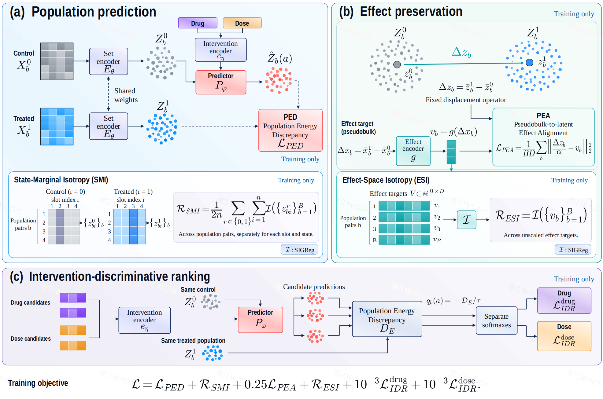

# PerturbJEPA

[English](README.md) | [简体中文](README.zh-CN.md)

Source code and configurations for five Parse10M experiments: **PerturbJEPA Tiny with visit/epoch loading, STATE Tiny with visit/epoch loading, and Linear-additive Ridge**. This repository contains the training, data loading, preprocessing and retrieval implementations. The five completed experiments are described below.

The comparatively smaller Parse10M dataset and Tiny models help users reproduce the complete workflow quickly with lower computational costs. Tahoe100M can use a similar data preparation, training and evaluation workflow, with dataset-specific adaptation, more computational resources and longer runtimes.

## Model architecture



Population prediction, effect preservation, and intervention-discriminative ranking. The reported Parse10M experiments use condition-ID embeddings; the dose branch shown here is disabled.

## Results

All metrics are macro averages; higher is better. MRR is the mean reciprocal rank of the correct perturbation. Recall@K measures whether it appears among the top K candidates.

| Experiment | Parameters | Selected step / α | Validation MRR | Test MRR | Recall@1 | Recall@5 | Recall@10 |
|---|---:|---:|---:|---:|---:|---:|---:|
| JEPA Tiny · visit | 7,132,352 | 32,214 | 0.7437 | 0.7631 | 70.14% | 82.94% | 84.75% |
| JEPA Tiny · epoch | 7,132,352 | 27,966 | 0.7825 | **0.7992** | **73.32%** | **86.69%** | **89.46%** |
| STATE Tiny · visit | 7,133,025 | 34,692 | 0.5593 | 0.5360 | 40.26% | 68.81% | 79.92% |
| STATE Tiny · epoch | 7,133,025 | 35,400 | 0.5680 | 0.5801 | 45.00% | 74.10% | 82.60% |
| Linear-additive Ridge | — | α = 1 | 0.5661 | 0.5662 | 46.60% | 67.28% | 76.41% |

### 1. PerturbJEPA Tiny · visit

JEPA predicts a perturbed population in a learned cell-state space, conditioned on a PBS control population and a cytokine condition ID. The Tiny model has a 128-dimensional state representation, a two-layer state encoder and a one-layer Token-AdaLN predictor, totaling 7,132,352 parameters.

The visit loader maintains population exposure and physical-cell visit counts throughout training. It favors less-visited cells and stops at the configured optimizer-step budget, without resetting counts at epoch boundaries. Training uses BF16, AdamW, a 5e-5 learning rate, cosine decay and five losses: population energy, state SIGReg, bulk-effect alignment, effect SIGReg and Rank-B.

The model trains for 35,400 steps. Validation selects step 32,214; test **MRR is 0.7631 and Recall@1 is 70.14%**. Configuration: [parse10m_tiny_visit_35400.yaml](configs/parse10m_tiny_visit_35400.yaml).

### 2. PerturbJEPA Tiny · epoch

This experiment uses the same JEPA architecture, initialization seed, losses, optimizer, precision, batch size, step budget and evaluation schedule. The loader shuffles all 5,307 training populations each epoch, visits each once and resamples the cells within each population.

There are 354 optimizer steps per epoch, so 35,400 steps correspond to 100 epochs. Validation selects step 27,966; test **MRR is 0.7992 and Recall@1 is 73.32%**, the highest values among these five runs. The test MRR exceeds JEPA visit by approximately 0.0361 in this single-seed comparison. Configuration: [parse10m_tiny_epoch_35400.yaml](configs/parse10m_tiny_epoch_35400.yaml).

### 3. STATE Tiny · visit

The STATE baseline predicts perturbed cell populations directly in expression space. This adaptation uses full-gene input/output projections, condition embeddings, a two-layer Transformer, hidden size 104 and four attention heads. It has 7,133,025 parameters, close to the JEPA Tiny parameter count. Implementation provenance is retained in [state_reference.json](src/baselines/state_reference.json).

Training uses the visit loader, FP32, Adam, a constant 3e-4 learning rate and expression-space energy loss. It trains from scratch for 35,400 steps. Validation selects step 34,692; test **MRR is 0.5360 and Recall@1 is 40.26%**. Configuration: [parse10m_state_tiny_visit_35400.yaml](configs/parse10m_state_tiny_visit_35400.yaml).

### 4. STATE Tiny · epoch

This run keeps the STATE visit model and numerical training settings, replacing visit sampling with shuffled epoch traversal. The budget remains 35,400 optimizer steps, with validation and checkpointing every 354 steps.

Validation selects step 35,400; test **MRR is 0.5801 and Recall@1 is 45.00%**. Its test MRR exceeds STATE visit by approximately 0.0441 in this run. Configuration: [parse10m_state_tiny_epoch_35400.yaml](configs/parse10m_state_tiny_epoch_35400.yaml).

### 5. Linear-additive Ridge

This baseline fits full-population mean perturbation responses over all 32,425 genes in CP10K+log1p expression space:

```text
predicted_delta = intercept + cell_type_effect + factor_effect
predicted_expression = control_mean + predicted_delta
```

Donors are averaged equally, and Ridge regression fits training-set responses with an unpenalized intercept. Validation pair-equal delta MSE selects α from `0.01, 0.1, 1, 10, 100`. The selected **α=1** has validation delta MSE **0.0002901757**. The model is not refitted on validation data; test data are excluded from fitting and selection.

Each candidate predicts a mean point, scored with expression-space energy-MMD in the same retrieval task. Test **MRR is 0.5662 and Recall@1 is 46.60%**. Implementation: [linear.py](src/baselines/linear.py).

## Shared evaluation protocol

- Parse10M v1, `drug_cell_type` combination holdout: held-out factor–cell-type combinations, with all candidate factors represented in training.
- All 32,425 retained genes and 90 candidate cytokines; 256 PBS control cells and 256 treated cells per query.
- Macro aggregation averages donors within each factor × cell type, then factors within a cell type, then cell types.
- All four neural models train from scratch with seed `42`, batch size `15` and 35,400 optimizer steps. Validation and checkpointing occur every 354 steps. Validation macro MRR selects the model before the final test.
- Loader comparisons control numerical settings within each model family. JEPA and STATE retain their respective loss, optimizer and precision settings. These are single-seed results; raw distance scales differ between representations.

Visit consumes 531,000 population pairs. Epoch consumes 530,700 because each epoch has a final batch of 12 pairs. The optimizer-step budgets match; population-pair counts differ by approximately 0.0565%.

## Layout

```text
configs/                  Four neural experiment configurations
assets/                   Model architecture figure
src/perturbjepa/           JEPA model, training, checkpoint selection and retrieval
src/baselines/             STATE and Linear baselines
src/data/                  CSR storage, epoch sampling and visit loading
src/process/Parse10M/      Sparse preprocessing
requirements-train.txt    Training dependencies
README.md                 English experiment descriptions
README.zh-CN.md           Chinese experiment descriptions
LICENSE                   MIT license
```

## Installation and local data

Dataset: [BGI-Hangzhou-OmicsAI/Parse10M on Hugging Face](https://huggingface.co/datasets/BGI-Hangzhou-OmicsAI/Parse10M). Download the data and configure the local data layout described below.

The verified environment uses Python 3.12. Run commands from the repository root:

```bash
python -m pip install -r requirements-train.txt
export PYTHONPATH="$PWD/src"
```

Provide a Parse10M v1 CSR export and its `drug_cell_type` split manifests locally. The configurations default to `data/parse10m/v1`, resolved relative to the repository root through `../data/parse10m/v1` in each YAML. Change `data.dataset_root` to your own export location when needed.

The export must contain `manifest.json`, `genes.npy`, `export.SUCCESS`, the CSR blocks and `splits/drug_cell_type/{train,val,test}.jsonl`. Split manifests and expression data are supplied separately. Preprocessing exports expression blocks; it does not generate the study's train/validation/test split.

To preprocess a local H5AD file:

```bash
python -m pip install h5py scipy
python src/process/Parse10M/preprocess.py run \
  --source data/parse10m/Parse10M.h5ad \
  --output data/parse10m/v1 --scan-genes
```

Preprocessing applies a detected-cell gene filter, CP10K+log1p normalization and population eligibility filtering, and writes sparse CSR blocks. It reads the source H5AD without modifying it. Dashboard generation is outside this package.

## Run the experiments

Run each command separately with one visible GPU and a new output directory. Add `--check` to validate local inputs before training. Tracking is disabled by default; configurations can enable SwanLab when desired.

```bash
CUDA_VISIBLE_DEVICES=0 python -m perturbjepa.train \
  --config configs/parse10m_tiny_visit_35400.yaml \
  --output-dir outputs/jepa_visit

CUDA_VISIBLE_DEVICES=0 python -m perturbjepa.train \
  --config configs/parse10m_tiny_epoch_35400.yaml \
  --output-dir outputs/jepa_epoch

CUDA_VISIBLE_DEVICES=0 python -m baselines.state \
  --config configs/parse10m_state_tiny_visit_35400.yaml \
  --output-dir outputs/state_visit

CUDA_VISIBLE_DEVICES=0 python -m baselines.state \
  --config configs/parse10m_state_tiny_epoch_35400.yaml \
  --output-dir outputs/state_epoch

CUDA_VISIBLE_DEVICES=0 python -m baselines.linear \
  --config configs/parse10m_tiny_epoch_35400.yaml \
  --query-dir data/frozen_queries --output-dir outputs/linear \
  --swanlab-mode disabled
```

Neural training includes validation-based checkpoint selection and final retrieval evaluation. Linear requires local frozen queries: a directory with `val/` and `test/`, each containing `queries.jsonl`, `truth.jsonl`, `cells.npz` and `manifest.json`. Reuse these artifacts from a neural retrieval run to compare the same physical cells; `--query-dir` must point to their common parent. The Linear runner checks data and query fingerprints before evaluation.

The published configurations retain the reported numerical recipes. Deployment paths and tracking defaults are portable. Local expression data, model weights and run metadata are not distributed with the source package.

## License and provenance

[MIT](LICENSE). Existing notices are retained for the [JEPA core](src/perturbjepa/core/LICENSE), [baselines](src/baselines/LICENSE) and [visit sampler](src/data/LICENSE.perturb). STATE provenance is recorded in [state_reference.json](src/baselines/state_reference.json).
