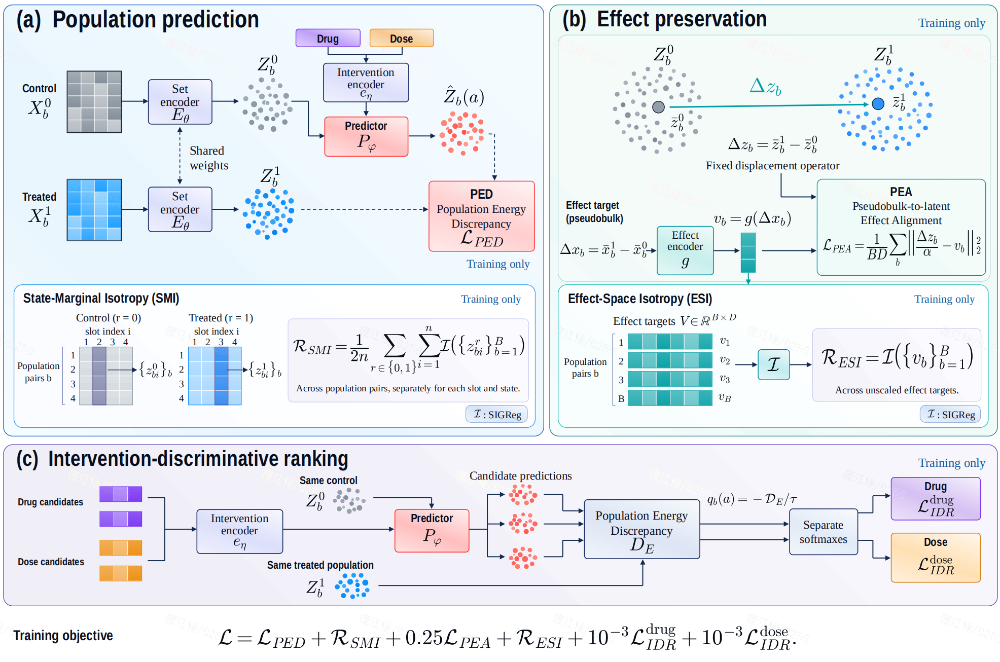

# PerturbJEPA

[English](README.md) | [简体中文](README.zh-CN.md)

本仓库提供 Parse10M 上五组实验的源码与配置：**PerturbJEPA Tiny visit/epoch、STATE Tiny visit/epoch，以及 Linear-additive Ridge**，包含训练、数据加载、预处理和检索实现。下面分别说明五组已完成实验。

本仓库选用规模相对较小的 Parse10M 数据集和 Tiny 模型，帮助用户以较低计算成本快速复现完整流程。Tahoe100M 可参照类似的数据准备、训练和评估步骤，但需要进行相应的数据适配，并投入更多计算资源和更长运行时间。

## 模型结构



模型包括群体预测、扰动效应保持和候选扰动排序三个部分。本文报告的 Parse10M 实验使用 condition ID 编码，图中的剂量分支未启用。

## 实验结果

全部指标为宏平均，越高越好。MRR 衡量正确扰动因子的倒数排名；Recall@K 表示正确因子进入前 K 名的比例。

| 实验 | 参数量 | 所选步数 / α | 验证 MRR | 测试 MRR | Recall@1 | Recall@5 | Recall@10 |
|---|---:|---:|---:|---:|---:|---:|---:|
| JEPA Tiny · visit | 7,132,352 | 32,214 | 0.7437 | 0.7631 | 70.14% | 82.94% | 84.75% |
| JEPA Tiny · epoch | 7,132,352 | 27,966 | 0.7825 | **0.7992** | **73.32%** | **86.69%** | **89.46%** |
| STATE Tiny · visit | 7,133,025 | 34,692 | 0.5593 | 0.5360 | 40.26% | 68.81% | 79.92% |
| STATE Tiny · epoch | 7,133,025 | 35,400 | 0.5680 | 0.5801 | 45.00% | 74.10% | 82.60% |
| Linear-additive Ridge | — | α = 1 | 0.5661 | 0.5662 | 46.60% | 67.28% | 76.41% |

### 1. PerturbJEPA Tiny · visit

JEPA 在学习到的细胞状态空间中预测扰动后的群体，输入为 PBS 对照细胞群体与 cytokine 的 condition ID。Tiny 模型使用 128 维状态表示、2 层状态编码器和 1 层 Token-AdaLN 预测器，共 7,132,352 参数。

visit 加载器在整个训练期间维护群体曝光与物理细胞访问计数，使访问较少的细胞获得更多采样机会。训练按优化器步数终止，计数不按 epoch 重置。使用 BF16、AdamW、5e-5 学习率和 cosine 调度，损失包括群体 energy、状态 SIGReg、bulk-effect 对齐、effect SIGReg 与 Rank-B 五项。

训练 35,400 步，验证选择第 32,214 步；测试 **MRR 为 0.7631，Recall@1 为 70.14%**。配置：[parse10m_tiny_visit_35400.yaml](configs/parse10m_tiny_visit_35400.yaml)。

### 2. PerturbJEPA Tiny · epoch

保持 JEPA visit 的模型、初始化种子、损失、优化器、精度、批量大小、总步数和评估节奏，将加载方式改为每轮打乱并遍历 5,307 个训练群体，各群体每轮出现一次，内部重新抽取细胞。

每轮 354 个优化器步，35,400 步对应 100 轮。验证选择第 27,966 步；测试 **MRR 为 0.7992，Recall@1 为 73.32%**，是这五组中的最高值。本次单种子实验中，测试 MRR 比 JEPA visit 高约 0.0361。配置：[parse10m_tiny_epoch_35400.yaml](configs/parse10m_tiny_epoch_35400.yaml)。

### 3. STATE Tiny · visit

STATE 基线直接在表达空间中预测扰动后的细胞群体。本地适配使用全基因输入/输出映射、condition embedding、2 层 Transformer、104 维隐层和 4 个注意力头，共 7,133,025 参数，与 JEPA Tiny 的参数量接近。实现来源保留在 [state_reference.json](src/baselines/state_reference.json)。

使用 visit 加载器、FP32、Adam、3e-4 恒定学习率和表达空间 energy loss，从头训练 35,400 步。验证选择第 34,692 步；测试 **MRR 为 0.5360，Recall@1 为 40.26%**。配置：[parse10m_state_tiny_visit_35400.yaml](configs/parse10m_state_tiny_visit_35400.yaml)。

### 4. STATE Tiny · epoch

保持 STATE visit 的模型和数值训练设置，将 visit 采样改为每轮打乱、遍历所有训练群体的 epoch 模式。预算仍为 35,400 个优化器步，每 354 步验证和保存。

验证选择第 35,400 步；测试 **MRR 为 0.5801，Recall@1 为 45.00%**。本次实验中，测试 MRR 比 STATE visit 高约 0.0441。配置：[parse10m_state_tiny_epoch_35400.yaml](configs/parse10m_state_tiny_epoch_35400.yaml)。

### 5. Linear-additive Ridge

该基线使用全部 32,425 个基因在 CP10K+log1p 表达空间中的完整群体均值，拟合可加性扰动效应：

```text
predicted_delta = intercept + cell_type_effect + factor_effect
predicted_expression = control_mean + predicted_delta
```

先对供体等权聚合，再以 Ridge 回归拟合训练集响应，截距不参与正则。α 从 `0.01 / 0.1 / 1 / 10 / 100` 中按验证集组合等权 delta MSE 选择。本次选中 **α=1**，验证 delta MSE 为 **0.0002901757**。验证数据不并入训练集重拟合，测试数据不参与拟合和选参。

每个候选输出一个均值点，在同一检索任务中用表达空间 energy-MMD 评分。测试 **MRR 为 0.5662，Recall@1 为 46.60%**。实现：[linear.py](src/baselines/linear.py)。

## 统一评估协议

- 使用 Parse10M v1 的 `drug_cell_type` 组合留出划分：留出因子与细胞类型的组合，所有候选因子均在训练中出现。
- 使用全部 32,425 个保留基因、90 个候选 cytokine；每个查询含 256 个 PBS 对照细胞和 256 个处理细胞。
- 宏平均先对同一因子 × 细胞类型内的供体取平均，再对各类型内的因子取平均，最后对细胞类型取平均。
- 四个神经网络均从头训练，seed 为 `42`、batch 为 `15`、优化器步数为 35,400；每 354 步验证和保存，按验证宏平均 MRR 选模后进行最终测试。
- 加载方式的控制变量比较在各自模型内部成立。JEPA 和 STATE 使用各自的损失、优化器与精度配方。这里只报告一个训练种子的结果，不同表示空间的原始距离值不直接比较。

visit 共消费 531,000 组群体配对；epoch 每轮末批为 12 组，合计 530,700 组。两者对齐优化器步数，实际群体配对数相差约 0.0565%。

## 代码结构

```text
configs/                  四组神经网络实验配置
assets/                   模型结构图
src/perturbjepa/           JEPA 模型、训练、选模与检索
src/baselines/             STATE 和 Linear 基线
src/data/                  CSR 存储、epoch 采样和 visit 加载
src/process/Parse10M/      稀疏表达预处理
requirements-train.txt    训练依赖
README.md                 英文实验说明
README.zh-CN.md           中文实验说明
LICENSE                   MIT 许可证
```

## 安装与本地数据

本项目使用的数据集：[Hugging Face · BGI-Hangzhou-OmicsAI/Parse10M](https://huggingface.co/datasets/BGI-Hangzhou-OmicsAI/Parse10M)。下载后，按下述目录结构配置本地数据。

验证环境为 Python 3.12，在仓库根目录执行：

```bash
python -m pip install -r requirements-train.txt
export PYTHONPATH="$PWD/src"
```

在本地准备 Parse10M v1 CSR 导出及其 `drug_cell_type` 划分清单。默认数据目录为仓库根目录下的 `data/parse10m/v1`，在各 YAML 中写为相对配置文件的 `../data/parse10m/v1`。可按需要修改 `data.dataset_root`。

导出需包含 `manifest.json`、`genes.npy`、`export.SUCCESS`、CSR 表达块，以及 `splits/drug_cell_type/{train,val,test}.jsonl`。划分清单和表达数据需另行准备；预处理脚本负责导出表达块，不生成本次研究的训练/验证/测试划分。

处理本地 H5AD 文件：

```bash
python -m pip install h5py scipy
python src/process/Parse10M/preprocess.py run \
  --source data/parse10m/Parse10M.h5ad \
  --output data/parse10m/v1 --scan-genes
```

预处理执行基因检出过滤、CP10K+log1p 归一化及群体资格过滤，输出稀疏 CSR 块；原始 H5AD 只读。当前发布内容不含 dashboard 生成步骤。

## 运行五组实验

以下命令分别运行，每次使用一张可见 GPU 和新的输出目录；加 `--check` 可先校验本地输入。默认关闭跟踪服务，可在配置中按需要启用 SwanLab。

```bash
CUDA_VISIBLE_DEVICES=0 python -m perturbjepa.train \
  --config configs/parse10m_tiny_visit_35400.yaml \
  --output-dir outputs/jepa_visit

CUDA_VISIBLE_DEVICES=0 python -m perturbjepa.train \
  --config configs/parse10m_tiny_epoch_35400.yaml \
  --output-dir outputs/jepa_epoch

CUDA_VISIBLE_DEVICES=0 python -m baselines.state \
  --config configs/parse10m_state_tiny_visit_35400.yaml \
  --output-dir outputs/state_visit

CUDA_VISIBLE_DEVICES=0 python -m baselines.state \
  --config configs/parse10m_state_tiny_epoch_35400.yaml \
  --output-dir outputs/state_epoch

CUDA_VISIBLE_DEVICES=0 python -m baselines.linear \
  --config configs/parse10m_tiny_epoch_35400.yaml \
  --query-dir data/frozen_queries --output-dir outputs/linear \
  --swanlab-mode disabled
```

神经网络入口集成验证选模与最终检索评估。Linear 需要本地冻结查询目录，其中 `val/` 和 `test/` 各含 `queries.jsonl`、`truth.jsonl`、`cells.npz` 与 `manifest.json`。可复用神经网络某次检索生成的这些文件，确保使用同一批物理细胞；将 `--query-dir` 指向两种划分所在的共同父目录。Linear 运行前会校验数据和查询指纹。

公开配置保留本次实验的数值配方，数据路径和跟踪默认值已改为通用设置。本源码包不分发表达数据、模型权重或运行元数据。

## 许可与来源

使用 [MIT 许可证](LICENSE)，并保留已有来源声明：[JEPA 核心](src/perturbjepa/core/LICENSE)、[基线](src/baselines/LICENSE)、[visit 采样](src/data/LICENSE.perturb)。STATE 实现来源记录于 [state_reference.json](src/baselines/state_reference.json)。
